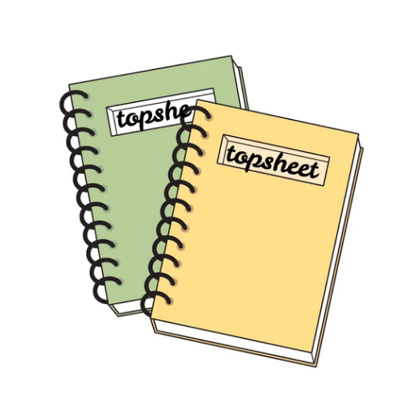

<div align="center">



# Topsheet

Cover pages for assignments and practicals.


</div>

---

## About

Almost every assignment or practical in a polytechnic starts with the same page: a cover page with the department, subject, teacher and your own name, roll and index. Making it in MS Word takes time, and a lot of students don't have a laptop, let alone a printer. Most just copy one generic template again and again.

Topsheet does it from your phone. Put your details in once, pick a subject, add the teacher, and you get a PDF you can print or send.

It started as a small web tool Ruhan built in our first semester at MAWTS Institute of Technology. This is that same idea, moved to Android where students actually are.

## App info

| | |
| --- | --- |
| Platform | Android |
| Price | Free |
| License | MIT, open source |
| Package | `com.thekami.topsheet` |
| Account | Not needed |
| Ads / analytics | None |
| Your data | Stays on your device |

## How it works

1. Set up your profile once: name, roll or index, institute, department, semester.
2. Pick a subject. The list is filtered by your department and semester.
3. Fill in the rest. Your profile is pre-filled and earlier entries (like teacher names) are remembered.
4. Generate the PDF.
5. Share it from any app, or take it to a print shop.

Everything you make is saved in a library, grouped by month. You can open, edit, share or delete any of them later.

## Features

- Guided form for course, student and teacher details
- Profile auto-fill and remembered entries
- Print-ready PDF output
- Library of all your topsheets, by month
- Works offline after the first load
- 16 colour palettes, plus Dynamic colour that follows your wallpaper
- Light, dark and system themes, with a pure black option for AMOLED
- Short setup that you can skip

## Technical info

| | |
| --- | --- |
| App | [Flutter](https://flutter.dev), Dart, Material 3 |
| PDF | [pdf](https://pub.dev/packages/pdf), [printing](https://pub.dev/packages/printing) |
| Storage | [sqflite](https://pub.dev/packages/sqflite), `shared_preferences` |
| Links | [url_launcher](https://pub.dev/packages/url_launcher) |
| CI/CD | GitHub Actions: signed builds, GitHub Releases, Play Store publishing |

**Open data.** Institutes, departments and subjects are not hard-coded. The app downloads them as plain JSON from [topsheet-data](https://github.com/asikrshoudo/topsheet-data) and keeps a local copy for offline use. If your institute or subject is missing, you can open a PR there.

## Build from source

```bash
flutter pub get
flutter run
```

Release builds:

```bash
flutter build apk --release
flutter build appbundle --release
```

## Download

| Where | Link |
| --- | --- |
| Google Play | [Topsheet on Google Play](https://play.google.com/store/apps/details?id=com.thekami.topsheet) |
| APK | [Latest GitHub release](https://github.com/thekami-dev/topsheet/releases/latest) |

## Contributors

<p align="center">
  <a href="https://github.com/asikrshoudo"></a>
  &nbsp;
  <a href="https://github.com/Ruhannn"></a>
  &nbsp;
  <a href="https://github.com/tkami-dev"></a>
</p>

Issues and pull requests are welcome.

## Privacy

No account, no ads, no analytics. What you type and the PDFs you make stay on your device. The only network use is loading the subject data, and Google Fonts (Inter) on the first run on some devices. Full details in the [Privacy Policy](https://blog.thekami.tech/posts/topsheet-privacy-policy/).

## Community

| Platform | Link |
| --- | --- |
| Discord | [Join the Thekami community](https://www.thekami.tech/discord/) |
| Instagram | [@thekami_official](https://www.instagram.com/thekami_official) |
| LinkedIn | [Thekami](https://www.linkedin.com/company/thekamiofficial) |
| Facebook | [thekamidev](https://www.facebook.com/thekamidev/) |
| GitHub | [thekami-dev](https://github.com/thekami-dev) |
| Support the project | [supportkori.com/thekami](https://www.supportkori.com/thekami) |

Blog post: [What is Topsheet?](https://blog.thekami.tech/posts/what-is-topsheet/)

## License

MIT © [Thekami](https://www.thekami.tech)

---

<p align="center">
  <a href="https://www.thekami.tech"></a>
</p>
